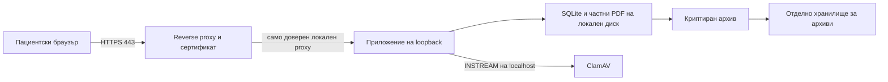

# План за Patient Portal с достъп през интернет

**Версия 18. Предложение за внедряване; HOLD / NO-GO.**

## Взети решения и текущ резултат

На 29.10.2026 потребителят избра достъп на пациентите през интернет от вкъщи и потвърди, че **няма регистриран домейн и осигурен сървър**. Потребителят даде работното име „Анакиевски“. Предложен базов домейн е `anakievski.bg`, адрес на портала `portal.anakievski.bg`; това са предложения, регистрационната наличност/правата върху името не са потвърдени. Доставчик/бюджет още не са избрани. Този документ не е поръчка, договор или извършено внедряване.

Локалният Windows сценарий е потвърден в определения обхват: ClamAV ready, legacy scan, ново качване/публикуване, owner preview/download, other-user denial, encrypted backup6 files и потребителско потвърждение на restore/drill. WINDOWS_ACCEPTANCE_BG.md различава screenshots от устно потвърждение. Самият архив, DB, PDF, пароли и ключове остават локални.

## Предложена първа архитектура

За първи staging етап предлагаме един отделен Linux VPS в ЕС/ЕИП, със системна поддръжка от отговорен администратор. Българският интерфейс и съществуващите patient/staff URL се запазват. Начален ориентир за оценяване на оферти: **4 vCPU,8 GiB RAM,80 GiB SSD**, с възможност за увеличаване. Това не е измерен капацитет или гаранция за брой пациенти; обемът на PDF, паралелните входове, Argon2 и ClamAV трябва да се измерят в избраната среда. Не е избрана платена услуга или текуща цена.

Публичният адрес се предлага като `portal.anakievski.bg` след проверка/регистрация на основния `anakievski.bg`. Публичната DNS NS проверка от 29.10.2026 не откри делегация за `anakievski.bg`, `anakievski-med.bg` и `anakievski.eu` (NXDOMAIN); това не доказва регистрационна свобода. Отделният sanitized запис е reports/domain_dns_observation.json. Стъпките за избора са в DOMAIN_AND_HOSTING_BG.md. Регистрацията се прави на медицинския център с определен отговорник и защита на registrar акаунта. DNS, hosting и backup достъпите се пазят отделно от потребителските акаунти на портала. Браузърът достига HTTPS proxy; приложението и ClamAV се обслужват вътрешно. Конкретни DNS/firewall/service настройки се подготвят след избора на домейн/сървър и се прилагат само по отделна одобрена процедура.

Първият проект остава single-host с локална SQLite и частен storage, съобразно проверения модел. Преминаване към PostgreSQL, SMB/NFS, повече машини или shared load balancer изисква отделен дизайн: сегашните shared slots и SQLite backup не доказват работа в такава архитектура. Не обещаваме 24/7 работа от личния Windows компютър; за сървъра трябва да има мониторинг и поддръжка.

## Конкретна граница в сегашния код

Проверено е чрез прочит на source, без стартиране на legacy приложението:

- `app/candidate_runtime.py:read_config` отказва `PORTAL_ENV=production`; `backend_environment` задава loopback hosts и non-Secure cookies за синтетичния кандидат. Desktop/scanner са foreground инструменти. Това е полезният локален тестов профил.
- `tools/run_candidate.py` слуша само 127.0.0.1 и използва `proxy_headers=False`. Няма публичен production launcher, който просто да се включи с домейн.
- `app/portal.py` има production host/Secure-cookie/HTTPS/MFA проверки, но `pdf_av_policy` и общият междупроцесен admission се включват от отделния candidate bootstrap. Пряк legacy старт не е равнозначен на проверения кандидат.
- `app/production_check.py` зарежда `portal`; import-ът може да създава таблици/прави legacy schema промени. Този стар инструмент не е read-only deployment проверка и не трябва да се използва за автоматична инвентаризация на реална инсталация.

**Нужният следващ кодов етап** е отделен, прегледан production bootstrap и versioned schema процедура. Той трябва да запази AV attestation/legacy hold, shared admission, freshness, ownership/CSRF, audit и backup lifecycle; да включи HTTPS/Secure cookies/точен hostname/staff MFA; да няма demo seeds, import-time DDL или silent migration. Всеки тест за него е в нов синтетичен staging store. Настоящите candidate guard-ове не се премахват и HOLD не се превключва чрез нов флаг.

## Последователност за изпълнение

| Етап | Конкретен резултат | Условие за преминаване |
| --- | --- | --- |
| 1. Домейн и hosting | Избрано име, оферта, регион, администратор и backup услуга | Собственикът избира доставчика/разходите; договорните и privacy условия са прегледани |
| 2. Production bootstrap | Прегледан код и явна schema процедура, запазващи всички PDF защити | Regression тестове върху нови синтетични данни; независим преглед на разликите |
| 3. Изолирана staging среда | HTTPS с точен домейн, частни storage/clamd, обслужван update/backup/monitoring процес | Външен клиент проверява TLS, cookies, host/proxy trust и функционалния сценарий със synthetic данни |
| 4. Приемане на инфраструктурата | Измерени CPU/RAM/disk/latency, scanner outage/recovery, свежест, възстановяване от отделно backup хранилище | Има конкретни evidence и независим technical/security/privacy review |
| 5. Реална употреба | Отделна празна одобрена среда, истински staff identities/MFA и процедура за пациентски достъп | Независимият преглед разрешава промяна на HOLD и собственикът одобрява конкретното внедряване |

Тези 5 етапа са deployment резултати, не още 5 серии от едни и същи локални тестове. Завършените Windows PDF/backup проверки не се повтарят без конкретна причина. При промяна на код се проверява съответната regression suite; target/network/storage измененията се доказват в избраната среда.

## Технически договор за staging/production предложението

HTTPS сертификатът трябва да се обновява автоматично с наблюдение за изтичане. Proxy trust се ограничава до конкретния собствен proxy; външни Forwarded/X-Forwarded-* headers не са доверени сами по себе си. Трябва да се запазят ограниченията за заглавки, body/time/connection/rate и да се проверява поведението при претоварване. PDF upload остава 15 MiB, legacy delivery64 MiB, общият admission2 PDF операции/1 upload за проверения two-worker single-host профил. Стойностите са началният проверен договор, не сертифициран общ RAM/throughput bound.

За нови upload/rescan се изискват истински clamd INSTREAM verdict и 48h freshness; error/timeout/unknown/stale/oversize остават отказ. Подписаните ClamAV бази се обновяват в собствен управляван процес, с наблюдение за грешка/стари сигнатури. Foreground Windows helper с ръчно ежедневно restart не се приема автоматично за unattended server deployment. Scanner процесът и logs се преглеждат за привилегии и минимално съдържание; patient PDF не се записва в публична директория.

Предвиждат се encrypted disks/private storage, отделно криптирано backup хранилище, ключ/парола под определена отговорност и измерен restore. Съществуващият backup е offline: графикът трябва да осигури контролирана пауза или отделно прегледан online-backup дизайн, а не да заобикаля lifecycle lock. Целевите срокове за допустима загуба и възстановяване на данни се определят от центъра, не се измислят от тестовете.

Staff входът трябва да изисква силна парола и TOTP; регистрацията, смяната на оператори и аварийното възстановяване на MFA трябва да имат ясна процедура. За пациента центърът определя как потвърждава самоличност и връчва достъп. Документи/пароли/ключове не се изпращат през проектния GitHub или chat. Logs/история/архиви се съхраняват според определена retention политика, с ограничен достъп.

Прегледът на обработването на здравни данни, договорите с hosting/backup доставчика и GDPR/DPIA screening е от компетентния независим отговорник. Регион ЕС/ЕИП и преминали тестове сами по себе си не удостоверяват съответствие. Функциите за роли/CSRF/ownership и default fail-closed поведение остават задължителни.

## Какво се променя с версия 18

Доставяме текущия код с актуален acceptance запис, този план и задание за независим преглед. Runtime backend, schema, Windows/scanner/backup инструменти и старите тестове са запазени. UI label за новия source еv1.18. Домейн/сървър не са купувани, няма публичен listener/тунел или real-data import. Няма `.env`, service, firewall, DNS или production промени. Следва избор на име и доставчик, паралелно с подготовка на отделния прегледан bootstrap.
